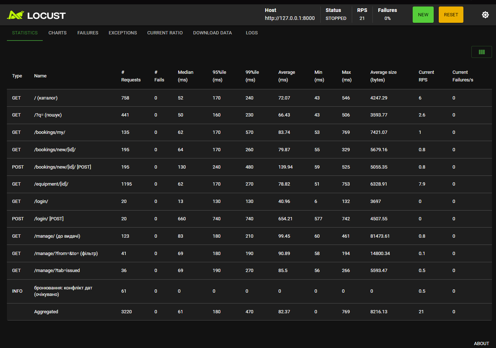
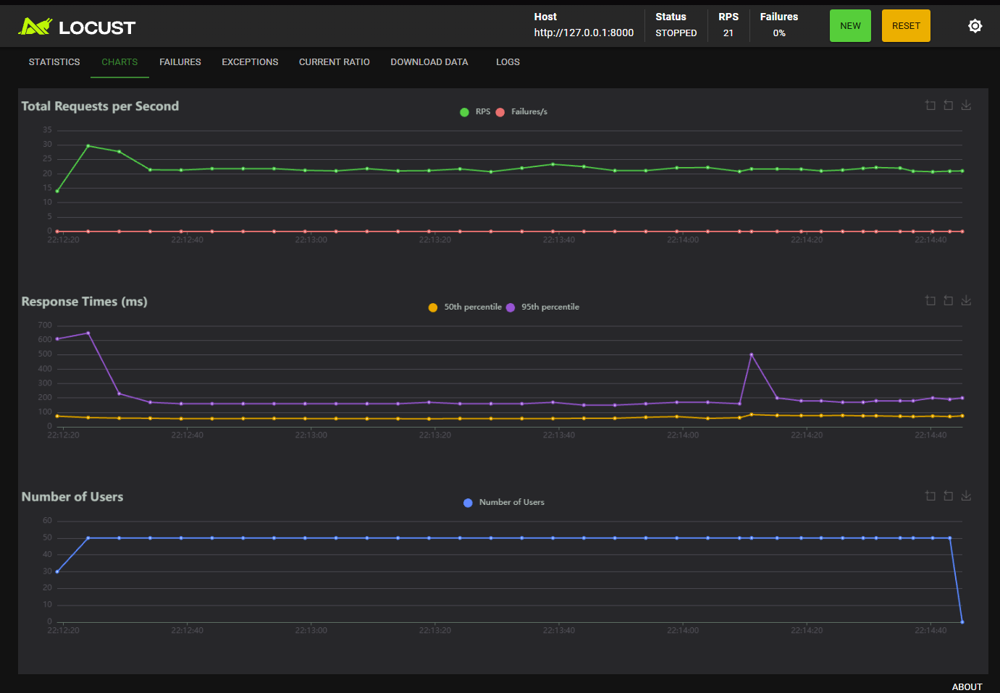
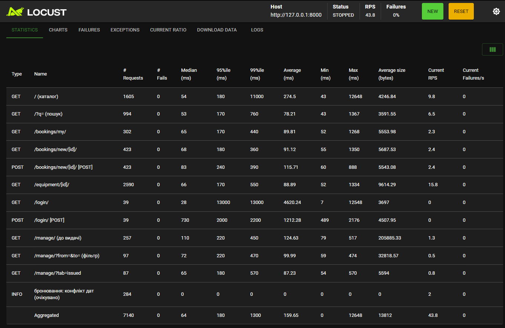
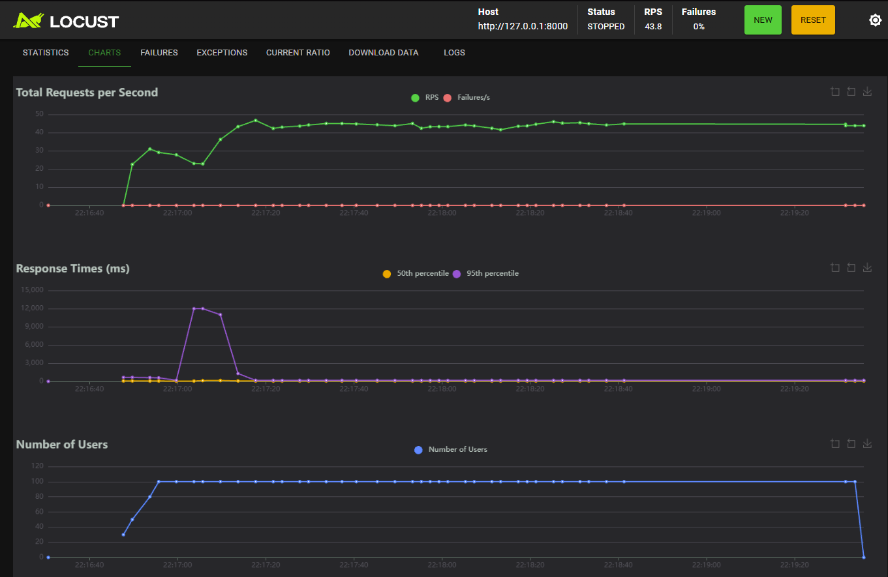

# Навантажувальне тестування

## Мета

Перевірити, що система:

1. відповідає швидко, коли нею одночасно користуються десятки людей;
2. не повертає помилок сервера під навантаженням;
3. під навантаженням зберігає головне правило: **жодних перетинів бронювань одного екземпляра**.

## Інструменти

| Інструмент | Призначення |
|---|---|
| [Locust](https://locust.io) 2.47 | Генерує навантаження: віртуальні користувачі виконують сценарії, описані на Python |
| [Waitress](https://docs.pylonsproject.org/projects/waitress/) 3.0 | Багатопотоковий WSGI-сервер; працює й на Windows. Вбудований `runserver` для вимірювань не підходить: він призначений лише для розробки |

Обидва встановлюються з `requirements-dev.txt` і для роботи сайту не потрібні.
Запускаються через `python.exe -m ...`, тому окремі `.exe`-файли зі `Scripts` не потрібні.

## Сценарії (`loadtest/locustfile.py`)

| Віртуальний користувач | Частка | Пауза між діями | Дії (вага) |
|---|---|---|---|
| Гість | 60 % | 1–3 с | каталог (3), пошук (2), картка обладнання (4) |
| Клієнт | 30 % | 2–5 с | вхід; картка обладнання (4); **бронювання** на випадкові дати в межах 120 днів, 1–5 діб (3); «Мої бронювання» (2) |
| Менеджер | 10 % | 2–5 с | вхід; панель «До видачі» (3), «Видані» (1), фільтр за періодом (1) |

Бронювання відбувається так само, як у браузері: відкрити форму, взяти CSRF-токен,
вибрати екземпляр, надіслати форму. Відповідь вважається успішною у двох випадках:

- бронювання створено (перехід на сторінку заявки);
- період уже зайнятий (форма з поясненням «уже заброньовано»). Це очікувана
  поведінка: випадкові дати часто перетинаються. Такі випадки рахуються окремим
  рядком «конфлікт дат (очікувано)».

Будь-яка інша відповідь, зокрема помилка сервера 5xx, рахується як збій.

## Як запустити

Навантаження створює сотні бронювань, тому тест проводиться на **окремій базі**.

1. Створити порожню базу, наприклад у pgAdmin:

   ```sql
   CREATE DATABASE rental_load OWNER rental;
   ```

2. Встановити інструменти:

   ```
   .venv\Scripts\python.exe -m pip install -r requirements-dev.txt
   ```

3. У терміналі (cmd) тимчасово переключитися на цю базу, вимкнути режим налагодження
   й підготувати дані:

   ```
   set POSTGRES_DB=rental_load
   set DJANGO_DEBUG=false
   .venv\Scripts\python.exe manage.py migrate
   .venv\Scripts\python.exe manage.py seed_demo
   .venv\Scripts\python.exe manage.py seed_loadtest --clients 100
   ```

   Змінні, задані через `set`, діють лише в цьому вікні терміналу; файл `.env` не змінюється.

4. У тому ж вікні запустити сервер:

   ```
   .venv\Scripts\python.exe -m waitress --listen=127.0.0.1:8000 --threads=8 config.wsgi:application
   ```

5. В іншому вікні терміналу запустити Locust:

   ```
   .venv\Scripts\python.exe -m locust -f loadtest/locustfile.py --host http://127.0.0.1:8000
   ```

   Відкрити http://localhost:8089, указати **Number of users** (50 або 100) і
   **Ramp up** (10 — скільки користувачів додається щосекунди), натиснути **Start**.
   Через 2–3 хвилини натиснути **Stop**. Результати є на вкладках **Statistics**
   і **Charts**, а на вкладці **Download Data** їх можна завантажити в CSV.

   Той самий тест без вебінтерфейсу, з автоматичною зупинкою й збереженням CSV:

   ```
   .venv\Scripts\python.exe -m locust -f loadtest/locustfile.py --headless -u 50 -r 10 -t 150s --host http://127.0.0.1:8000 --csv results/u50
   ```

6. Перевірити, що під навантаженням не виникло перетинів:

   ```sql
   SELECT count(*) AS overlaps
   FROM bookings_booking a
   JOIN bookings_booking b
     ON a.unit_id = b.unit_id AND a.id < b.id
    AND daterange(a.start_date, a.end_date + a.buffer_days, '[)')
     && daterange(b.start_date, b.end_date + b.buffer_days, '[)')
   WHERE a.status IN ('confirmed', 'issued')
     AND b.status IN ('confirmed', 'issued');
   ```

   Очікуваний результат: `0`.

## Результати

**Середовище.** Ноутбук автора, Windows 11 (x64); PostgreSQL, Python 3.14,
Waitress (8 потоків), `DJANGO_DEBUG=false`. Сервер, база даних і Locust працювали
на одному комп'ютері, тому частину ресурсів процесора забирав сам генератор навантаження.

Тест запускався через вебінтерфейс Locust: 50, а потім 100 користувачів,
додавання по 10 користувачів за секунду, тривалість близько 2,5 хв кожен.
Другий прогін ішов на тій самій базі, тобто вже з бронюваннями першого.

Час відповіді наведено в мілісекундах: медіана, 95-й процентиль (95 % запитів були
швидшими за це значення) і максимум.

### 50 одночасних користувачів

| Запит | Кількість | Збої | Медіана | 95 % | Макс. |
|---|---:|---:|---:|---:|---:|
| Каталог | 758 | 0 | 52 | 170 | 546 |
| Пошук | 441 | 0 | 50 | 160 | 506 |
| Картка обладнання | 1195 | 0 | 62 | 170 | 753 |
| Форма бронювання (GET) | 195 | 0 | 64 | 170 | 329 |
| **Бронювання (POST)** | 195 | 0 | 130 | 240 | 525 |
| Мої бронювання | 135 | 0 | 62 | 170 | 769 |
| Сторінка входу (GET) | 20 | 0 | 13 | 130 | 132 |
| Вхід (POST) | 20 | 0 | 660 | 740 | 742 |
| Панель менеджера | 123 | 0 | 83 | 180 | 461 |
| Панель: фільтр за періодом | 41 | 0 | 69 | 180 | 194 |
| Панель: видані | 36 | 0 | 69 | 190 | 266 |
| **Усього** | **3159** | **0** | **61** | **180** | |

Пропускна здатність: 21 запит за секунду. Із 195 спроб бронювання 134 створили
бронювання, 61 отримала очікуваний конфлікт дат.





### 100 одночасних користувачів

| Запит | Кількість | Збої | Медіана | 95 % | Макс. |
|---|---:|---:|---:|---:|---:|
| Каталог | 1605 | 0 | 54 | 180 | 12 648 |
| Пошук | 994 | 0 | 53 | 170 | 1367 |
| Картка обладнання | 2590 | 0 | 66 | 170 | 1334 |
| Форма бронювання (GET) | 423 | 0 | 68 | 180 | 1350 |
| **Бронювання (POST)** | 423 | 0 | 83 | 240 | 888 |
| Мої бронювання | 302 | 0 | 65 | 170 | 1268 |
| Сторінка входу (GET) | 39 | 0 | 28 | 13 000 | 12 548 |
| Вхід (POST) | 39 | 0 | 730 | 2000 | 2176 |
| Панель менеджера | 257 | 0 | 110 | 220 | 517 |
| Панель: фільтр за періодом | 97 | 0 | 72 | 220 | 474 |
| Панель: видані | 87 | 0 | 65 | 180 | 570 |
| **Усього** | **6856** | **0** | **64** | **180** | |

Пропускна здатність: 43,8 запиту за секунду. Із 423 спроб бронювання 139 створили
бронювання, 284 отримали очікуваний конфлікт дат: база вже була заповнена
бронюваннями з першого прогону, тому вільних дат стало менше.





У рядку «Усього» не враховано службовий рядок Locust «конфлікт дат (очікувано)»:
це не окремі запити, а позначки результату бронювання.

### Сплеск затримок на початку тесту зі 100 користувачами

На графіку Response Times видно, що протягом приблизно 15 секунд одразу після
виходу на 100 користувачів 95-й процентиль піднявся до ~12 с. Потім він
повернувся до ~170–240 мс і до кінця тесту не змінювався. Саме ці секунди дали
великі максимуми в таблиці.

Причина — черга запитів, а не повільний код:

- найпростіша сторінка `/login/` (медіана 28 мс) у цей момент теж відповідала до 12,5 с,
  тобто запити чекали вільного потоку сервера, а не виконувалися повільно;
- сплеск збігається з моментом, коли близько 40 віртуальних клієнтів і менеджерів
  майже одночасно входили в систему. Вхід — найважча операція: Django перевіряє
  пароль хешем PBKDF2 з великою кількістю ітерацій (медіана 0,7 с, під час сплеску до 2,2 с).
  Ці операції зайняли процесор і потоки Waitress, і решта запитів стала в чергу;
- у тесті з 50 користувачами (вдвічі менше одночасних входів) сплеск був лише до ~0,6 с.

У реальній роботі така ситуація малоймовірна: користувачі входять раз за сеанс
і в різний час. Для перевірки цього пояснення можна повторити тест із повільнішим
додаванням користувачів (`Ramp up` = 2): тоді входи розподіляться в часі.

## Висновки

1. **Помилок немає.** За 10 015 запитів при 50 і 100 одночасних користувачах
   не було жодного збою (`Failures 0 %`).
2. **Сервер масштабується лінійно.** При подвоєнні кількості користувачів
   пропускна здатність теж зросла вдвічі (21 → 43,8 запиту/с), а медіана відповіді
   майже не змінилась (61 → 64 мс). Отже, в усталеному режимі сервер не був перевантажений.
3. **Швидкодія достатня.** Медіана сторінок гостя й клієнта 50–83 мс,
   95 % запитів швидші за 240 мс (без урахування короткого сплеску на старті).
4. **Головне правило працює під навантаженням.** 345 спроб забронювати вже зайнятий
   період отримали зрозумілу відмову, а не помилку сервера: перетин відхилило
   обмеження `booking_no_overlap_per_unit` у PostgreSQL.
5. **Вузьке місце — масовий одночасний вхід.** Хешування паролів навмисно повільне
   з міркувань безпеки. При одночасному вході багатьох користувачів воно створює
   чергу запитів (див. розділ про сплеск). У промисловій експлуатації це вирішується
   кількома процесами сервера та розподілом навантаження.
6. **Пагінація панелі менеджера.** Сторінка «До видачі» показувала всі заявки
   й рахувала кількість для кожної вкладки. Тому зі зростанням кількості бронювань
   вона ставала важчою: середній розмір сторінки зріс з 81 КБ до 206 КБ, а медіана
   часу відповіді — з 83 до 110 мс. **За результатами тесту додано поділ на сторінки
   по 20 заявок**, тож розмір сторінки більше не залежить від загальної кількості заявок.
   Наведені вище цифри отримано до цієї зміни.
